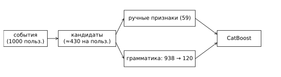
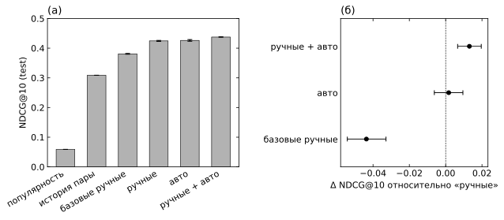

# Рекомендательная система на Yambda: ручные признаки против автоматической генерации

**Полный отчёт: [experiments/strong-features-20261025/README.md](experiments/strong-features-20261025/README.md).** В нём описаны постановка задачи, пайплайн и защита от утечек, подходы, эксперименты, результаты, анализ, вычислительные затраты, ограничения и команды воспроизведения. Протокол эксперимента: [PROTOCOL.md](experiments/strong-features-20261025/PROTOCOL.md).

## Кратко

- **Данные:** Yambda-50M, 1000 случайных пользователей со всей историей (5.04 млн событий).
- **Задача:** предсказать треки, которые пользователь дослушает (>50%) в следующие 7 дней.
- **Разбиение:** по неделям — train ×3 / dev / selection / test.
- **Кандидаты:** один общий набор, около 430 на пользователя.
- **Модель:** CatBoost.



*Рис. 1. Схема эксперимента. Для всех моделей используются одни и те же кандидаты и метки. Ручной набор и автоматический отбор из грамматики обучаются в одном и том же CatBoost.*

Результаты на test (NDCG@10, 3 seeds, гиперпараметры подобраны на dev):

| Подход | NDCG@10 | Δ к сильному ручному набору [95% CI] |
| --- | --- | --- |
| Популярность | 0.059 | −0.366 [−0.392; −0.340] |
| Число дослушиваний пары за 90 дней | 0.309 | −0.116 [−0.133; −0.099] |
| Базовый ручной набор (36 оконных счётчиков) | 0.381 | −0.044 [−0.054; −0.033] |
| Сильный ручной набор, 59 признаков | 0.424 | опора |
| Автоматический отбор из 938 SQL-агрегатов | 0.426 | +0.002 [−0.006; +0.010] |
| Ручной + автоматический | 0.438 | +0.013 [+0.007; +0.020] |



*Рис. 2. (а) NDCG@10 на test, планки показывают std по 3 seeds. (б) Разность с сильным ручным набором и 95% CI (paired bootstrap по пользователям).*

Автоматический отбор из грамматики `ключ × фильтр событий × окно × агрегация` сравнялся с ручным набором. Объединение двух наборов дало значимый прирост. Самый полезный ручной признак — ранг трека по давности в истории пользователя. Он лежит вне грамматики, и это показывает, в какую сторону её расширять.

## Предыдущий этап

Сначала сравнивались только временные окна счётчиков, без типов событий и метаданных треков. Использовались те же 1000 пользователей, кандидаты из 1000 популярных и 200 последних треков, жадный отбор окон на selection. Отбор окон дал NDCG@10 на 0.0029 ниже ручного набора окон 7 / 30 дней / вся история, 95% CI [−0.0089; 0.0032]. Преимущество не установлено. Этот вывод согласуется с итоговым: выбор окна сам по себе мало что даёт, прирост приносят новые виды признаков. Код этапа находится в `src/tlab_recsys` и `configs/`. Итоговый эксперимент использует из него загрузку и подготовку данных, а также прежние признаки как базовый ручной набор.

## Структура

| Путь | Что там |
| --- | --- |
| `experiments/strong-features-20261025/` | итоговый эксперимент: код (`strongfeat/`), тесты, конфигурация, отчёт, результаты |
| `src/tlab_recsys/` | загрузка и проверка Yambda/KION, подготовка выборки пользователей, базовые признаки и пайплайн предыдущего этапа |
| `configs/` | профили пайплайна предыдущего этапа; `expanded.json` задаёт выборку из 1000 пользователей |
| `tests/` | тесты пайплайна: временные границы, будущие события, сохранение истории пользователей, эталон агрегатов |

## Воспроизведение

Нужны Python 3.11–3.13 и `uv`.

```powershell
uv sync --frozen --dev
uv run pytest -q tests
uv run tlab-recsys download --dataset yambda
uv run tlab-recsys prepare --dataset yambda --profile expanded
cd experiments/strong-features-20261025
uv run --project ../.. python -m strongfeat.download_meta
uv run --project ../.. python -m pytest -q tests
uv run --project ../.. python -m strongfeat.run slices
uv run --project ../.. python -m strongfeat.run features
uv run --project ../.. python -m strongfeat.run screen
uv run --project ../.. python -m strongfeat.run select
uv run --project ../.. python -m strongfeat.run tune
uv run --project ../.. python -m strongfeat.run final --tuned
uv run --project ../.. python -m strongfeat.analyze final-tuned.json
uv run --project ../.. --with matplotlib python -m strongfeat.figures
```

Полный прогон на 4 ядрах занимает около полутора часов, пик памяти до 6 ГБ. Подробности и дополнительные стадии (финал с общими параметрами, абляция) описаны в отчёте эксперимента.
