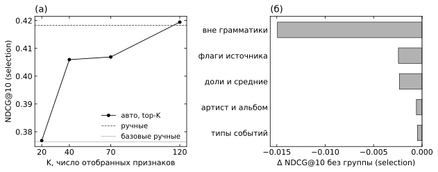

# Сильный ручной бейзлайн против автогенерации признаков (Yambda)

**Главный вывод.** Автоматический отбор из грамматики SQL-агрегатов (938 кандидатов) дал на test то же качество, что и сильный ручной набор: NDCG@10 0.4261 против 0.4244, Δ +0.0017, 95% CI [−0.006; +0.010]. Объединение обоих наборов дало 0.4375, это +0.013 [+0.007; +0.020] к ручному. Гиперпараметры каждого варианта подобраны на dev. С общими фиксированными параметрами вывод тот же. Автоматика не обогнала человека, но нашла признаки, которые дополняют ручные. Самый полезный ручной признак лежит вне грамматики: позиция трека в истории прослушиваний пользователя. Отсюда видно, чего грамматике не хватает.

Протокол записан в [PROTOCOL.md](PROTOCOL.md) до просмотра метрик моделей. Подбор гиперпараметров добавлен дополнением 1 до своего запуска. Все числа ниже взяты из [reports/results-tuned.json](reports/results-tuned.json), [reports/results.json](reports/results.json), [artifacts/main/](artifacts/main) и [reports/manual-ablation-selection.json](reports/manual-ablation-selection.json).

## Задача

- **Данные:** Yambda-50M, 1000 случайных пользователей (`cohort_seed=1729`, та же когорта, что в основном пайплайне проекта) со всей их историей, 5 040 719 событий и 278 889 треков. Типы событий: listen, like, dislike, unlike, undislike. У прослушиваний есть `played_ratio_pct` и `is_organic`. Исполнитель и альбом трека взяты из `artist_item_mapping.parquet` и `album_item_mapping.parquet`.
- **Задача:** в момент cutoff ранжировать кандидатов на следующие 7 дней. Положительный пример — пара (пользователь, трек), для которой в горизонте есть `listen` с `played_ratio_pct > 50`. Около 66% таких целей — треки, которые пользователь уже слушал. Пользователь, у которого есть цели, дослушивает за неделю в среднем около 90 различных треков.
- **Разбиение по времени:** шесть последовательных недель, train0–train2, dev, selection, test (cutoff 22371205 … 25395205 с). Признаки и кандидаты строятся только из событий с `timestamp < cutoff`, метки берутся только из `[cutoff, cutoff + 7 дней)`.
  - Модели учатся на train0–2.
  - dev используется только для early stopping и скрининга.
  - selection — только для выбора K.
  - test открыт один раз.

## Кандидаты

Один набор кандидатов для всех моделей, около 430 на пользователя:

| Источник | Сколько | Что это |
| --- | --- | --- |
| history | 400 | чаще всего дослушанные пользователем за 90 дней |
| recent | 100 | последние прослушанные различные треки |
| artist | 50 | неслышанные треки топ-10 исполнителей пользователя |
| popular | 100 | популярные в когорте за 7 дней |

Генератор покрывает 42–46% всех целей недели (на test 42%). Прежний пайплайн для сравнения брал 1200 кандидатов (1000 популярных и 200 последних). Метрики ранжирования считаются от **всех** целей недели, включая пропущенные генератором. Поэтому верхняя граница Recall@100 равна 0.42, и NDCG@10 ограничен тем же.

## Почему нет утечек

1. `features.compute` и `manual.extras` отказываются работать, если в переданной истории есть событие с `timestamp >= cutoff`. История режется функцией `history(events, q)` до вызова.
2. Тест `test_future_events_do_not_change_inputs`: события после cutoff перемешиваются (трек, тип события), после чего проверяется побайтовое совпадение кандидатов, всех 938 признаков грамматики и ручных признаков.
3. `test_labels_come_only_from_horizon`: метка равна 1 тогда и только тогда, когда цель лежит в `[q, q + 7 дней)`.
4. `test_engine_matches_naive_reference`: быстрый движок на Polars сверяется с наивным построчным расчётом.
5. Популярность для кандидатов и все агрегаты объектов считаются по прошлому той же когорты.
6. Исполнитель и альбом — статические свойства трека, а не наблюдения во времени.
7. Выбор K делается на selection, гиперпараметры CatBoost подбираются на dev, test не участвует ни в одном выборе. Число итераций задаёт early stopping на dev.

## Подходы

Все бустинги — CatBoost CPU, l2 3, до 2000 итераций, early stopping 100 по Logloss на dev, seeds 17, 29, 43. Для каждого варианта depth {6, 8} × learning_rate {0.05, 0.1} подбирается по NDCG@10 на dev (seed 17). Выбрано: old manual, manual и auto — depth 6, lr 0.05; auto + manual — depth 8, lr 0.1.

- **Strong manual (59 признаков).** 48 агрегатов из грамматики выбраны вручную ([manual.py](strongfeat/manual.py)). Они покрывают:
  - активность и вкус пользователя;
  - популярность и качество трека: доля дослушиваний и пропусков, лайки и дизлайки;
  - прямую связь пользователь × трек;
  - косвенные связи пользователь × исполнитель и пользователь × альбом.

  К ним добавлены 7 признаков вне грамматики: тренды трека и исполнителя, текущее состояние лайка или дизлайка, ранг трека по давности в истории пользователя, возраст трека, длина трека. Ещё 4 признака — флаги источника кандидата.
- **Auto-grammar.** Пространство признаков задаётся как `ключ × фильтр × окно × агрегация`, всего 938 спецификаций ([features.py](strongfeat/features.py)):
  - ключ: user, item, artist, album, user×item, user×artist, user×album;
  - фильтр: all, listen, full >50%, skip <20%, like, dislike, organic;
  - окно: 1, 3, 7, 14, 30, 90 дней и вся история;
  - агрегация: count, recency, средний played_ratio, число различных треков, доли full/skip/like от прослушиваний, доля пары в дослушиваниях пользователя.

  Каждый признак — один `SELECT agg … WHERE timestamp < q AND timestamp >= q − window AND filter GROUP BY key`. Отбор идёт в два шага:
  1. Скрининг на 300 случайных пользователях: вся грамматика строится на train0–2 и dev, обучается одна модель, признаки ранжируются по PredictionValuesChange. Признак с |corr| > 0.98 к более важному удаляется, остаются первые 120.
  2. Выбор K ∈ {20, 40, 70, 120} по NDCG@10 на selection.
- **Auto + manual.** Ручной набор вместе с теми автоматическими признаками, которых в нём нет. Вариант заранее записан в протоколе.
- **Опорные точки:**
  - популярность;
  - число дослушиваний пары за 90 дней (без обучения);
  - old manual — 36 агрегатов прежнего пайплайна (`src/tlab_recsys/features.py`, только импорт) и категориальные user_id, item_id на тех же кандидатах.

## Результаты на test

Указано среднее ± std по 3 seeds. Δ — paired bootstrap по пользователям: разности сначала усредняются по seeds, затем 2000 повторов, seed 2718. 754 пользователя имеют цели в неделе test.

| Вариант | Признаков | NDCG@10 | Recall@10 | Recall@100 | ROC-AUC | LogLoss | Δ NDCG@10 к strong manual [95% CI] | Обучение, с | Итераций |
| --- | --- | --- | --- | --- | --- | --- | --- | --- | --- |
| Popular (7 дней) | — | 0.0589 | 0.0136 | 0.0523 | 0.4841 | — | −0.3655 [−0.3916; −0.3399] | — | — |
| History count (90 дней) | — | 0.3088 | 0.0703 | 0.2643 | 0.8372 | — | −0.1157 [−0.1325; −0.0991] | — | — |
| Old manual (прежний пайплайн) | 38 | 0.3808 ± 0.0013 | 0.0855 | 0.2764 | 0.8366 | 0.1906 | −0.0437 [−0.0542; −0.0329] | 108 | 57 |
| **Strong manual** | 59 | 0.4244 ± 0.0017 | 0.0966 | 0.3088 | 0.8723 | 0.1753 | опора | 99 | 550 |
| Auto-grammar (K=120) | 124 | 0.4261 ± 0.0028 | 0.0948 | 0.3058 | 0.8693 | 0.1759 | +0.0017 [−0.0062; +0.0095] | 212 | 769 |
| **Auto + manual** | 165 | **0.4375 ± 0.0005** | 0.0986 | 0.3121 | 0.8713 | 0.1752 | **+0.0131 [+0.0066; +0.0196]** | 126 | 231 |

Тот же финал с общими параметрами (depth 6, lr 0.08), записанный в протоколе до первого открытия test:

| Вариант | NDCG@10 | Δ к strong manual [95% CI] |
| --- | --- | --- |
| Old manual | 0.3792 ± 0.0029 | −0.0452 [−0.0561; −0.0343] |
| Strong manual | 0.4244 ± 0.0003 | опора |
| Auto-grammar | 0.4246 ± 0.0006 | +0.0002 [−0.0079; +0.0082] |
| Auto + manual | 0.4413 ± 0.0009 | +0.0170 [+0.0100; +0.0239] |

Подбор почти не изменил test: manual 0.4244 → 0.4244, auto 0.4246 → 0.4261, объединение 0.4413 → 0.4375. На dev выигрыш от подбора виден лучше: manual 0.452 при lr 0.05 против 0.442–0.449 при других параметрах. Но dev одновременно служит для early stopping, поэтому эти оценки оптимистичны. Объединение на test с подобранными параметрами оказалось чуть хуже, чем с общими. Это обычный шум выбора по одной неделе, вывод от него не меняется.

Порядок вариантов на selection тот же: strong manual 0.418, auto K=120 0.419, old manual 0.376.


*Рис. 1. (а) NDCG@10 на test для всех вариантов, планки показывают std по 3 seeds. (б) Разность с strong manual и 95% CI (paired bootstrap по пользователям).*

## Анализ

**Что дал сильный бейзлайн.** Он лучше прежнего ручного набора на +0.045 NDCG@10. Абляция на selection (seed 17, test не используется) показывает, какие группы дают вклад:

| Убранная группа | Признаков | NDCG@10 selection | Δ |
| --- | --- | --- | --- |
| ничего | 59 | 0.4183 | — |
| 7 признаков вне грамматики (`x_*`) | 52 | 0.4033 | −0.0149 |
| доли, средние, nuniq, share | 49 | 0.4159 | −0.0024 |
| флаги источника кандидата | 55 | 0.4158 | −0.0024 |
| косвенные: исполнитель и альбом | 43 | 0.4177 | −0.0006 |
| типы событий: like, dislike, skip, organic | 47 | 0.4178 | −0.0005 |



*Рис. 2. (а) NDCG@10 на selection в зависимости от числа K автоматически отобранных признаков; горизонтальные линии показывают ручные наборы. (б) Изменение NDCG@10 на selection, если убрать из ручного набора одну группу признаков.*

Главный вклад дают признаки вне грамматики. По важности в моделях первого финала среди них первый `x_pair_recency_rank` — место трека в отсортированной по давности истории пользователя, второй по важности признак модели. Его альтернатива в грамматике, абсолютная давность `user_item recency`, значит меньше. Ранг нормирует время на темп конкретного пользователя. Косвенные связи и типы событий по отдельности почти ничего не добавляют: при доминирующих повторных прослушиваниях эту информацию в основном несут прямые признаки пары.

**Что нашла автоматика.** По сумме важности в auto-моделях первого финала лидируют ключи user (51%) и user×item (37%). Косвенные user×artist и user×album вместе дают 9%, а item только 2%. Окна выбраны широко: «вся история» 26 признаков, 90 дней 19, 30 дней 22, 14 и 7 дней по 17, 3 дня 11, 1 день 8. Человеческие окна 7 / 30 / вся история не оказались особенными. Автоматика часто берёт 90 и 14 дней, которых в ручном наборе почти нет. С ручным набором совпали только 14 из 120 спецификаций. Рост на selection по K: 20 → 0.377, 40 → 0.406, 70 → 0.407, 120 → 0.419. Лучшим оказался верхний край сетки, так что K > 120 мог бы дать ещё немного.

**Почему объединение лучше обоих.** Ручной набор приносит то, чего грамматика не выражает: ранги внутри пользователя, тренды, состояние лайка. Автоматика приносит альтернативные окна и пользовательские нормировки, например `nuniq` за 3 и 7 дней и mean played_ratio за 3–14 дней. Значит, грамматику стоит расширять не новыми окнами, а новыми видами преобразований: ранг или перцентиль внутри пользователя, отношение короткого окна к длинному, последнее состояние. Это следующий шаг. В этот запуск он не вошёл, потому что изменение метода после просмотра test сделало бы сравнение нечестным.

**Вычислительные затраты** (облачный контейнер, 4 vCPU, 15 ГБ):

| Стадия | Время | Пик RSS |
| --- | --- | --- |
| 6 срезов кандидатов и меток | 29 с | 2.2 ГиБ |
| Ручные признаки, 6 срезов | ≈4.5 с на срез | 2.1 ГиБ |
| Скрининг: 938 признаков × 300 пользователей × 4 среза | 44 с признаки + 87 с обучение | 4.8 ГиБ |
| Выбор K: 4 обучения + 2 опорных | 620 с | 5.5 ГиБ |
| Финал с общими параметрами: 4 варианта × 3 seeds | 1519 с | 5.8 ГиБ |
| Подбор на dev: 4 варианта × 4 комбинации | 2236 с | 4.9 ГиБ |
| Финал с подобранными параметрами | 1647 с | 5.8 ГиБ |

Весь автоматический поиск, то есть скрининг и выбор K, занял около 12.5 минуты против 0 для ручного набора. Плюс ручной работы — экспертное время. С подобранными параметрами модель auto обучается примерно в 2 раза дольше manual (212 против 99 с) из-за большего числа признаков и итераций. Расчёт всей грамматики линеен по числу строк кандидатов. Для 1000 пользователей это около 2.2 ГБ float32 на срез, поэтому скрининг и делается на подвыборке пользователей. Для 10 000 и более пользователей его стоит выполнять так же, а полные признаки строить только для отобранных K.

## Ограничения

- Одна когорта из 1000 активных пользователей и один временной период. Агрегаты объектов и популярность считаются только по когорте, а не по всему сервису.
- Bootstrap учитывает выборку пользователей, но не неопределённость скрининга, выбора K и seed подвыборки.
- Сетка гиперпараметров маленькая (4 комбинации), и выбор по dev делается на той же неделе, что и early stopping.
- Генератор кандидатов ограничивает Recall@100 значением 0.42. Улучшение генератора в этой работе не исследовалось.
- Прежний пайплайн проекта на своих кандидатах получил NDCG@10 около 0.37 на selection. Числа здесь с ним сравнимы только в строке old manual, где признаки те же, а кандидаты новые.

## Воспроизведение

Нужны `uv sync --frozen --dev` в корне проекта, исходный `data/data_yambda/raw/flat/50m/multi_event.parquet` и подготовленная выборка из 1000 пользователей. Обе загружает основной пайплайн: `uv run tlab-recsys download --dataset yambda` и `uv run tlab-recsys prepare --dataset yambda --profile expanded`. Метаданные треков скачивает `strongfeat.download_meta` с проверкой размера и SHA256.

```powershell
cd experiments/strong-features-20261025
uv run --project ../.. python -m strongfeat.download_meta
uv run --project ../.. python -m pytest -q tests
uv run --project ../.. python -m strongfeat.run slices
uv run --project ../.. python -m strongfeat.run features
uv run --project ../.. python -m strongfeat.run screen
uv run --project ../.. python -m strongfeat.run select
uv run --project ../.. python -m strongfeat.run final
uv run --project ../.. python -m strongfeat.run tune
uv run --project ../.. python -m strongfeat.run final --tuned
uv run --project ../.. python -m strongfeat.ablate
uv run --project ../.. python -m strongfeat.analyze
uv run --project ../.. python -m strongfeat.analyze final-tuned.json
uv run --project ../.. --with matplotlib python -m strongfeat.figures
```

Путь к данным берётся из [configs/experiment.json](configs/experiment.json) относительно корня проекта (`--root` меняет корень). Число потоков CatBoost задаётся там же (`thread_count=4`). Матрицы признаков кешируются в `artifacts/main/features/` и в репозиторий не входят. Использованы polars 1.44.2, catboost 1.2.10 и Python 3.13. Версии polars и catboost совпадают с `uv.lock` проекта.
